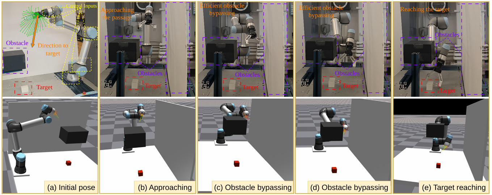

# CLIS-MPPI

**Closed-Loop Model Predictive Path Integral Control With Initial-State Sampling Under Execution Delay**

**Zidong Liu and Xu Chen**

Department of Mechanical Engineering, University of Washington

Accepted to the **65th IEEE Conference on Decision and Control (CDC 2026)**.

[Project Website](https://macs-lab.github.io/CLIS-MPPI/) | [Paper](static/pdfs/paper.pdf) | [arXiv](https://arxiv.org/abs/2610.21239) | [BibTeX](citation.bib)

CLIS-MPPI addresses the mismatch between the state used during planning and the actual robot state at control execution. It models execution delay as initial-state uncertainty, samples initial states and control sequences, and combines the MPPI feedforward update with rollout-based local feedback correction.



The method is evaluated on a 6-DoF UR5e manipulator performing narrow-passage obstacle avoidance and target reaching. See the project website and paper for the method, experimental results, and evaluation details.

## Updating resource links

Edit [`static/js/config.js`](static/js/config.js):

```js
window.CLIS_CONFIG = Object.freeze({
  paperUrl: "./static/pdfs/paper.pdf", // Replace with a public paper or PDF URL.
  arxivUrl: "https://arxiv.org/abs/2610.21239",
  videoUrl: "",                      // Add an external video URL when available.
  videoFile: ""                      // Or use ./static/videos/experiment.mp4.
});
```

- **Paper:** Updating `paperUrl` changes all three paper links on the page. The included PDF remains the fallback when JavaScript is unavailable.
- **arXiv:** The button links to the public preprint. Keep the fallback link in `index.html` synchronized with `arxivUrl` so it also works without JavaScript.
- **Demo / Video:** With no video configured, Demo links to the experiment image. An external URL enables the Video link; a local video file enables the embedded player and takes precedence over the external URL. Videos do not autoplay.
- **BibTeX:** The citation section supports copying and downloading. Keep the citation in `index.html` synchronized with `citation.bib` when adding publication metadata.

Resource links accept full HTTP(S) URLs or project-relative paths beginning with `./`. Use filenames without spaces.

## Website files

| File | Purpose |
| --- | --- |
| `index.html` | Page content, authors, results table, and displayed citation |
| `citation.bib` | Downloadable BibTeX citation |
| `static/js/config.js` | Paper, arXiv, and video resource links |
| `static/js/main.js` | Resource-link behavior and citation copying |
| `static/css/style.css` | Responsive layout and print styles |
| `static/images/` | Paper figures, paper preview, and official logo assets |
| `static/pdfs/paper.pdf` | Included manuscript |
| `.nojekyll` | Static-file publishing configuration |

This is a static HTML/CSS/JavaScript website with no build step, external fonts, CDN dependencies, or tracking scripts. Figures link to their original-resolution images.

## Local preview

From the repository directory, run:

```powershell
python -m http.server 8000 --bind 127.0.0.1
```

Open http://127.0.0.1:8000/ in a browser. Press Ctrl+C to stop the server.

## GitHub Pages

The site is served from the root of `main`. In **Settings > Pages**, select **Deploy from a branch**, choose **main** and **/(root)**, and save. Push subsequent changes to `main` to update the site.

Website: https://macs-lab.github.io/CLIS-MPPI/

## Acknowledgment

This work was supported in part by an Amazon-UW Science Hub Gift Award.

## Design and asset credits

The page layout is inspired by the [MACS Lab robotic inspection project](https://macs-lab.github.io/robotic-inspection-orientation-control-2026/) and [Nerfies](https://nerfies.github.io/). The HTML, CSS, and JavaScript were implemented independently.

Official logo files are displayed with their original colors and aspect ratios:

- **University of Washington:** [UW Brand](https://www.washington.edu/brand/brand-elements/logos/), [original Block W PNG](https://cdn.uw.edu/wp-content/uploads/sites/230/2023/11/02134808/W-Logo_Purple_Hex.png).
- **Amazon:** [Amazon Press Center](https://press.aboutamazon.com/logos?p=4), [original PNG](https://assets.aboutamazon.com/2e/d7/ac71f1f344c39f8949f48fc89e71/amazon-logo-squid-ink-smile-orange.png). The support label links to the [UW+Amazon Science Hub](https://www.sciencehub.uw.edu/).
- **CDC 2026:** [Official conference website](https://cdc2026.ieeecss.org/), [original logo PNG](https://confcats-siteplex.s3.us-east-1.amazonaws.com/cdc26/thumbnail_cdc2026logo_ankush_e3ca6c947a.png).

Brand marks belong to their respective owners.
